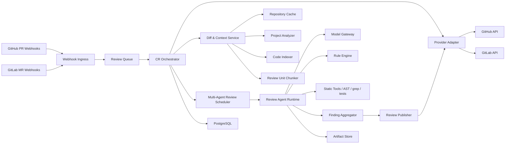

# AI Code Review Agent Service Architecture

日期：2026-07-07

## 1. 目标与边界

本服务是 GitHub PR / GitLab MR 自动 Code Review 服务，不提供 Web 工作台，不创建 coding task，不自动改代码、推分支或合并。

核心流程：

1. GitHub/GitLab 通过 webhook 通知 PR/MR 创建或更新。
2. 服务拉取 diff、代码上下文、项目分析文件和历史评论。
3. 系统拆分 review units，构建 context pack，并用多 agent 并行审查。
4. Aggregator 聚合、去重、校验证据和控制噪音。
5. Publisher 写回 summary comment、inline comments、check/status。

核心原则：

- **Review-only**：只读代码并写评论/状态。
- **Context-first**：不只看 diff，先理解项目结构、上下文和复用点。
- **Evidence-based**：无证据不发 inline comment。
- **Provider-neutral**：GitHub/GitLab 差异只在 Provider Adapter 中处理。
- **Large PR compatible**：大 PR/MR 通过分片、并行、摘要和降级处理。
- **Low-noise**：少而准，避免重复评论和低价值建议。

## 2. 总体架构



组件职责：

| 组件 | 职责 |
| --- | --- |
| Webhook Ingress | 验签、幂等、落原始事件、入队 |
| Provider Adapter | 封装 GitHub/GitLab 的 diff、文件、评论、status/check API |
| Project Analyzer | 生成项目分析文件，沉淀架构、函数方法、复用点和注意事项 |
| Diff & Context Service | 构建 PatchSet、ReviewUnit、ContextPack |
| Multi-Agent Review Scheduler | 将 review unit DAG 并行分配给 CR agents |
| Review Agent Runtime | 执行规则检查、上下文审查、模型调用和输出校验 |
| Model Gateway | 统一接入 OpenAI、DeepSeek、GLM/Z.AI、自定义兼容模型 |
| Finding Aggregator | 合并、去重、证据校验、噪音预算控制 |
| Review Publisher | 写回 summary、inline comments、check/status |

## 3. PR/MR 触发流程

1. 收到 PR/MR webhook。
2. 验签并计算幂等键：`provider + repo + change_request_id + head_sha + event_type`。
3. 拉取 PR/MR 元数据、base/head commit、changed files、diff 和已有评论。
4. 如果项目分析文件缺失或过期，运行 Project Analyzer。
5. 构建 PatchSet，并判断规模等级。
6. Basic CR Rule Engine 标记 review path。
7. Chunker 生成 review unit DAG。
8. Context Pack Builder 为每个 review unit 构建证据包。
9. Scheduler 并行启动 CR agents。
10. Aggregator 聚合 findings，过滤重复、低置信度、无法定位或证据不足的问题。
11. Publisher 写回 PR/MR。

## 4. GitHub/GitLab 抽象

| 内部抽象 | GitHub | GitLab |
| --- | --- | --- |
| ChangeRequest | Pull Request | Merge Request |
| Event | pull_request / issue_comment / review_comment | merge_request / note / push |
| PatchSet | PR files + commits + diff | MR changes + commits + diff |
| InlineComment | PR review comment | MR discussion/note |
| SummaryComment | issue comment / check summary | MR note |
| ReviewStatus | check run / commit status | external status / status check |
| Installation | GitHub App installation | OAuth / project token / group token / bot token |

接入建议：

- GitHub 优先使用 GitHub App 和 installation access token。
- GitLab 支持 GitLab.com 和 self-managed base URL。
- Self-managed GitLab 做能力探测，按能力启用 inline/status/comment。
- 支持 `/ai-review`、`/ai-review full`、`/ai-review file path/to/file` 等 comment command。

## 5. 项目分析文件

每个项目在首次接入、默认分支关键变化、依赖/目录结构大幅变化或项目 skill 更新后生成/刷新项目分析文件。

推荐位置：

- 内部：`project_analysis/<repository_id>/<default_branch_sha>.md`
- 仓库内可选：`.ai-review/project-analysis.md`

内容：

- Project overview：用途、技术栈、运行方式、构建/测试命令。
- Architecture map：目录结构、核心模块、入口点、分层边界。
- Function/method index：关键函数、类、service、controller、job、handler 职责。
- Data/contract map：API schema、DTO、DB migration、事件、配置、feature flag。
- Reuse catalog：已有 helper、service、hook、组件、权限、错误处理、事务、幂等、锁。
- Review notes：兼容逻辑、性能敏感路径、历史坑点。
- Test map：测试目录、工具、关键样例、相关测试定位方式。
- Project skill summary：项目级 CR 规则摘要。
- Freshness metadata：生成时间、default_branch_sha、覆盖范围、已知缺口。

项目分析文件只保存摘要和索引，不保存全量源码；实时 CR 仍读取 repository cache 和 provider API。

## 6. 基础 CR 规则

基础规则所有项目默认执行。项目级 skill 可以增强或收紧，但不能取消安全、证据、去重和降噪规则。

| 规则 | 触发条件 | 审查重点 | 发布要求 |
| --- | --- | --- | --- |
| 文件内局部变更 | 只改已有文件局部代码块 | diff block 与所在函数/类/模块上下文；命名、边界、错误处理、类型、并发、测试 | 问题能由局部上下文、类型、测试或静态规则证明 |
| 新增文件并被引入 | 新文件被已有文件 import/require/use | 先审新文件职责和导出 API，再审引入点是否合适 | 必须同时引用新文件证据和至少一个引入点证据 |
| 新增逻辑查复用 | 新增函数、分支、业务流程、转换、权限、错误处理、重试/幂等/事务等 | 先查 Project Analysis 的 Reuse catalog，再代码检索相似逻辑 | 必须给出可复用代码位置和复用理由 |

复用提示只在以下情况发布：

- 现有 helper/service/component/hook 能覆盖当前需求。
- 新实现与已有逻辑行为不一致。
- 新逻辑绕过已有权限、校验、事务、错误处理模式。

不发布泛泛的“建议抽公共方法”。

## 7. Review Unit 与并行调度

CR 不按文件粗暴拆分，而按语义单元拆分为 review unit DAG。可独立判断的 unit 并行审查，跨文件判断放到聚合阶段。

### ABC 示例

场景：B 是新文件，A/C 都新增了对 B 中函数 `B.fn` 的调用。

Review units：

```text
new-file:B
exported-api:B.fn
integration:A -> B.fn
integration:C -> B.fn
cross-file:B.fn adoption
```

并行调度：

```text
parallel:
  Agent 1 -> new-file:B
  Agent 2 -> exported-api:B.fn
  Agent 3 -> integration:A -> B.fn
  Agent 4 -> integration:C -> B.fn

after all above:
  Aggregator -> cross-file:B.fn adoption
```

单元职责：

- `new-file:B`：审 B 文件职责、导出 API、边界、错误处理、测试、是否重复已有能力。
- `exported-api:B.fn`：审函数契约、副作用、异常、前置条件、误用风险。
- `integration:A -> B.fn`：审 A 的调用位置、依赖方向、返回值/异常处理、行为变化和测试影响。
- `integration:C -> B.fn`：审 C 的业务上下文、边界条件、与 A 的使用差异。
- `cross-file:B.fn adoption`：聚合判断 A/C 是否一致使用 B.fn，B.fn 是否放对层，是否存在公共抽象、循环依赖或重复评论。

并发控制：

- 每个 PR/MR 设置最大并行 agent 数。
- 同一目录或同一 symbol 的 unit 可串行或半串行。
- auth、payment、migration、permission、data loss 等高风险 unit 优先。
- 单个 agent 超时只降级该 unit，不阻塞无依赖 unit。

## 8. Context Pack

每个 review unit 在进入 agent 前必须构建 Context Pack。没有足够上下文时，只发 summary warning 或内部 finding，不发布确定性的 inline comment。

Context Pack 包含：

- Local code window：diff 所在函数、类、文件上下文。
- Symbol graph：定义、引用、调用方、接口、类型声明。
- Dependency graph：import/export、模块边界、循环依赖风险。
- Contract context：API schema、DTO、DB migration、配置、feature flag。
- Test context：相关测试、fixtures、失败日志。
- Usage examples：相似实现、已有 helper、错误处理模式。
- History context：相关 commit、PR/MR、历史评论。
- Documentation context：README、ADR、注释中的约束。
- Runtime hints：类型检查、lint、静态分析、测试结果。

构建策略：

- 先用确定性工具：ripgrep、AST parser、language server、dependency analyzer。
- 按风险调上下文预算：安全/事务/权限/迁移类拿更多调用链和配置。
- 超大 PR/MR 先生成 file/module summary，再做上层聚合。
- 每个 context item 记录 source、path、line range、reason。

## 9. Findings 发布规则

### 证据等级

| 等级 | 含义 | 发布策略 |
| --- | --- | --- |
| A | 测试、类型检查、schema、静态规则、明确调用链证明 | 可发 inline |
| B | 相似实现、文档约束、接口契约支撑 | 可发 inline |
| C | 合理怀疑但证据不足 | 只进 summary 的“需人工确认” |
| D | 偏好、风格或无法验证 | 默认不发布 |

### “是否最优解”

只有能用仓库证据支撑时才发布，例如：

- 已有 helper/utility 可复用，新代码重复实现且行为不一致。
- 新代码绕过既有架构边界或权限层。
- 新实现引入可证明的复杂度、性能、安全或一致性风险。
- 新实现缺少仓库已有模式中的幂等、事务、锁、错误处理、回滚。
- 关键测试缺失，且仓库已有测试模式能证明应补。

不发布纯风格偏好、无收益的替代写法、无法验证的业务猜测。

### 输出结构

```json
{
  "summary": "整体审查结论",
  "risk_level": "low|medium|high|critical",
  "findings": [
    {
      "severity": "P0|P1|P2|P3",
      "category": "security|correctness|performance|maintainability|test",
      "file": "src/example.ts",
      "line": 42,
      "message": "面向作者的 CR 评论",
      "evidence": "为什么这是问题",
      "evidence_level": "A|B|C|D",
      "evidence_refs": ["src/example.ts:42"],
      "suggestion": "建议修改方向",
      "confidence": 0.87,
      "fingerprint": "stable-finding-id"
    }
  ]
}
```

发布前校验：

- 必须能映射到当前 diff 可评论行；否则降级 summary。
- 必须引用 context pack 证据；无证据不发 inline。
- 不发只有“考虑优化”的模糊评论。
- 同一根因跨多个调用点出现时，优先发一条 summary 或最关键 inline。

## 10. 项目级 Review Skill

每个项目可以定义 `.ai-review/SKILL.md`，用于补充项目规范。

可定义内容：

- 分层架构和禁止依赖方向。
- 必须复用的 helper/service/component。
- 特定目录审查重点，如 migration、payment、auth、infra。
- 允许/禁止的评论类型和 severity 阈值。
- 生成文件、兼容逻辑、性能敏感路径。
- 项目测试命令和验收标准。

加载顺序：

1. 平台基础 CR 规则。
2. 组织级 review policy。
3. 仓库级 review skill。
4. PR/MR label 或 comment command 临时覆盖。

安全、证据等级、secret 防泄露、fork PR 限制不能被项目 skill 放宽。

## 11. 多模型接入

Review Agent Runtime 不直接依赖某个模型 SDK，而是通过 Model Gateway 调用统一接口：

```ts
interface ReviewModelClient {
  review(input: ReviewModelInput, policy: ModelPolicy): Promise<ReviewModelOutput>
  streamReview?(input: ReviewModelInput, policy: ModelPolicy): AsyncIterable<ModelEvent>
}
```

适配器：

| Adapter | 用途 |
| --- | --- |
| OpenAI Adapter | 复杂推理、最终聚合、高风险 finding 复核；优先 Responses API |
| DeepSeek Adapter | 大批量分片审查和成本敏感场景；OpenAI-compatible Chat Completions |
| GLM / Z.AI Adapter | 国内/区域合规或 GLM 专用场景 |
| OpenAI-Compatible Adapter | 客户自带模型网关或私有模型 |

模型能力矩阵：

- `max_context_tokens`
- `supports_structured_output`
- `supports_json_mode`
- `supports_tool_calling`
- `supports_reasoning_effort`
- `supports_streaming`
- `region`
- `price_class`
- `reliability_class`

所有模型输出都经过 JSON Schema 校验；invalid JSON 可 repair 一次，仍失败则降级为 summary-only 或 failed_retryable。

## 12. 数据模型

核心表：

- `provider_installations`
- `repositories`
- `project_analysis_files`
- `project_review_skills`
- `change_requests`
- `change_request_events`
- `review_runs`
- `patch_sets`
- `review_units`
- `review_unit_dependencies`
- `agent_tasks`
- `context_packs`
- `context_items`
- `review_findings`
- `published_comments`
- `review_statuses`
- `model_providers`
- `model_configs`
- `model_credentials`
- `model_invocations`
- `artifacts`
- `audit_logs`

关键字段：

- `review_units.review_path`：如 `new-file`、`integration`、`cross-file-adoption`。
- `review_unit_dependencies`：DAG 边、依赖原因、聚合策略。
- `agent_tasks`：agent 状态、模型、开始/结束时间、超时、失败原因。
- `project_analysis_files`：branch、commit_sha、coverage、freshness、artifact_ref。

## 13. 状态机

```text
received
queued
loading_metadata
building_patchset
chunking
planning_agents
reviewing
aggregating
publishing
completed
```

异常状态：

- `skipped`：draft、只改文档、过大且未允许 full review 等。
- `failed_retryable`：rate limit、临时网络、worker 失败。
- `failed_terminal`：权限不足、配置错误、无法定位 diff。
- `canceled`：新 head_sha 到来或用户取消。

发布前必须再次校验 head_sha，避免旧 run 评论到新 diff。

## 14. 失败重试与降级

Agent 分析、模型调用、上下文构建和评论发布都必须支持幂等重试。重试粒度优先是 `agent_task` 或 `review_unit`，不是整次 `review_run`。

| 失败点 | 可重试 | 策略 |
| --- | --- | --- |
| Webhook 入队失败 | 是 | 使用幂等键重放事件 |
| Provider API 429/5xx | 是 | 指数退避，保留 review_run 状态 |
| Context Pack 构建超时 | 部分 | 缩小上下文预算，降级为 summary-only |
| Agent task 超时/崩溃 | 是 | 重试该 unit，最多 N 次，失败后标记 unit degraded |
| 模型 rate limit/timeout | 是 | 切换 fallback model 或延迟重试 |
| 模型 invalid JSON | 是 | repair 一次，仍失败则 summary-only |
| Aggregator 冲突 | 部分 | 二次 verification；仍冲突则进入“需人工确认” |
| 发布评论失败 | 是 | 按 provider comment id / fingerprint 幂等重试 |
| 权限不足/配置错误 | 否 | `failed_terminal`，写 summary/status 说明 |

重试预算：

- 每个 `agent_task` 有独立 retry_count、timeout、last_error。
- 同一 `review_unit` 默认最多重试 2 次；高风险 unit 可配置更高。
- 整个 `review_run` 有总时长和总 token 预算，超过预算后停止新任务并发布降级 summary。
- 新 head_sha 到来时，旧 run 标记 `canceled` 或 `superseded`，不继续重试。

降级输出：

- 单个 unit 失败不阻塞其他无依赖 unit。
- 依赖失败的聚合 unit 可以跳过，并在 summary 中说明未覆盖范围。
- 如果 inline comment 发布失败，保留 summary 和 status。
- 如果大部分 agent 失败，发布“review incomplete”状态而不是假装通过。

幂等要求：

- webhook、review_run、agent_task、published_comment 都要有稳定幂等键。
- 发布前再次校验 `head_sha`。
- inline comment 使用 finding fingerprint 去重，避免重试刷屏。

## 15. 安全与权限

- GitHub 优先 GitHub App installation token。
- GitLab 支持 bot/project/group token 和 self-managed 企业配置。
- Git provider token 与模型 API key 分开存储、授权和审计。
- 密钥只存 KMS/Secrets Manager 引用。
- Fork PR 默认不运行不可信代码，只做静态 diff review。
- 评论发布前做 secret scanning。
- customer-managed key 的连通性测试不包含真实源码。
- 可按仓库配置禁止源码发送到指定模型供应商。

## 16. 评论发布策略

- P0/P1：有 A/B 证据时发布。
- P2：按评论预算发布，证据不足则进 summary。
- P3：默认不发 inline。
- Huge PR/MR：默认不刷 inline，只发 summary、风险热区和拆分建议。
- 无高价值问题：只更新 status 或写简短 summary。

去重：

```text
fingerprint = provider + repo + change_request + file + normalized_line_context + category + normalized_message
```

## 17. 可观测性指标

系统：

- webhook 量、验签失败率、重复事件率。
- queue 延迟、review run 耗时、失败率。
- review unit DAG 节点数、边数、最大深度、可并行比例。
- agent 并发数、成功率、超时率、重试率、降级率、等待时间。
- context pack 构建耗时、命中率、token 使用。

质量：

- 平均评论数。
- finding resolve / reply / react 比例。
- false positive 反馈率。
- evidence level 分布。
- 无证据 finding 过滤率。
- 复用建议命中率和采纳率。
- 多 agent findings 冲突率、聚合去重率。

成本：

- 每个 review run / review unit token 成本。
- 并行调度节省的 wall-clock time。
- 每个 provider/model 的成功率、fallback 率、latency、成本。
- structured output 校验失败率、JSON repair 成功率。

## 18. MVP 计划

阶段 1：GitHub PR 自动 CR 闭环

- GitHub App、webhook 验签、PR opened/synchronize 触发。
- Project Analysis File v1。
- Basic CR Rule Engine v1。
- Context Pack Builder v1。
- Model Gateway v1。
- Multi-Agent Review Scheduler v1，最多 4 个并行 CR agents。
- agent_task 级重试、超时、fallback model 和 review incomplete 状态。
- summary comment、少量 inline comments、check/status。

阶段 2：GitLab MR 支持

- GitLab.com token/OAuth。
- MR webhook。
- MR note、discussion、external status。
- self-managed base URL 和能力探测。

阶段 3：超大 PR/MR

- Large/Huge 分级。
- diff hunk chunker。
- file/module summary。
- repo cache + 本地 diff fallback。
- 动态并发策略。
- 增量审查和 finding fingerprint 去重。

阶段 4：治理与质量

- 项目级 review skill。
- comment command。
- customer-managed model keys。
- fork PR 策略。
- secret scanning、audit hardening。

## 19. 风险与应对

| 风险 | 应对 |
| --- | --- |
| 只看 diff 误判 | 强制 Context Pack 和证据引用 |
| 超大 PR/MR 太慢 | review unit DAG + 多 agent 并行 |
| Agent 分析中途挂掉 | agent_task 级重试，失败 unit 降级，不阻塞无依赖 unit |
| 项目分析文件过期 | 绑定 default_branch_sha，关键变化刷新 |
| 低价值评论过多 | evidence level、confidence、noise budget |
| 行级评论 API 差异 | Provider Adapter 统一定位和 fallback |
| 新 commit 评论错位 | 发布前校验 head_sha，必要时 remap |
| Fork PR 恶意代码 | 默认不运行 fork 代码 |
| 模型输出漂移 | JSON Schema、repair、二次 verification |
| 密钥泄露 | KMS、日志脱敏、租户隔离 |

## 20. 官方资料依据

- GitHub App installation token：GitHub App 可生成 installation access token。
- GitHub Checks：check run 写权限适用于 GitHub Apps。
- GitHub Webhooks：PR webhook payload 包含 repository、pull request、installation 等信息。
- GitLab REST authentication：支持 OAuth 2.0 token、personal/project/group access token。
- GitLab Merge Requests API：可管理 MR 并连接外部工具。
- GitLab Webhooks：支持 merge request、push、note 等事件。
- GitLab External Status：可将外部状态显示到 commit 或 MR。
- OpenAI Responses API：用于模型请求、工具和结构化输出工作流。
- DeepSeek API：兼容 OpenAI/Anthropic 格式。
- Z.AI / GLM Chat Completion：提供 `/paas/v4/chat/completions`。

参考链接：

- https://docs.github.com/en/apps/creating-github-apps/authenticating-with-a-github-app/authenticating-as-a-github-app-installation
- https://docs.github.com/rest/checks/runs
- https://docs.github.com/en/webhooks/webhook-events-and-payloads
- https://docs.github.com/rest/pulls/comments
- https://developers.openai.com/api/reference/responses/overview
- https://developers.openai.com/api/docs/guides/structured-outputs
- https://api-docs.deepseek.com/
- https://api-docs.deepseek.com/api/create-chat-completion
- https://docs.z.ai/api-reference/llm/chat-completion
- https://docs.gitlab.com/api/rest/authentication/
- https://docs.gitlab.com/api/merge_requests/
- https://docs.gitlab.com/user/project/integrations/webhooks/
- https://docs.gitlab.com/ci/ci_cd_for_external_repos/external_commit_statuses/
- https://docs.gitlab.com/api/status_checks/
